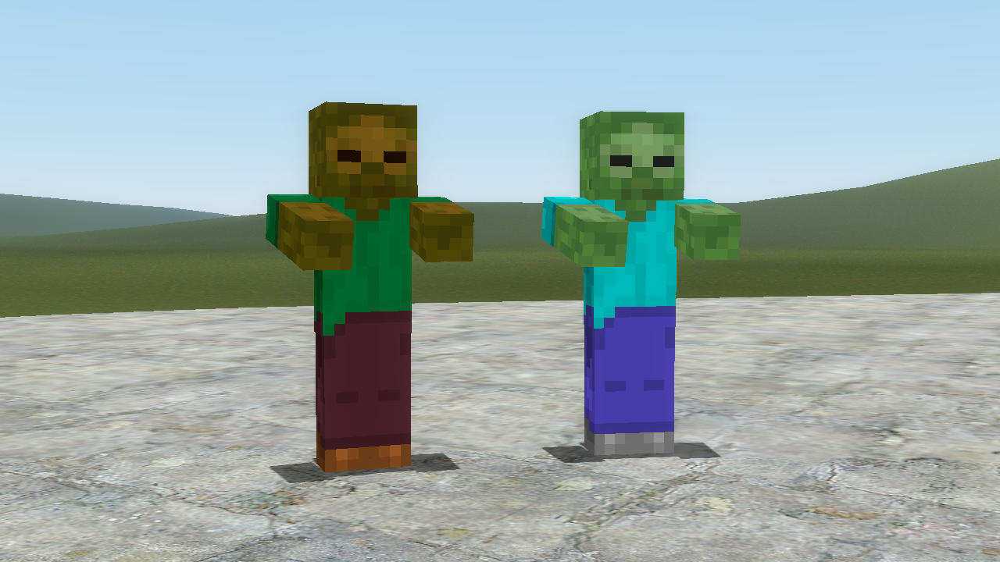

# BMB Custom Mob Example: Ember Zombie

[中文版](README.zh-CN.md)

A minimal, working custom mob for [Minecraft in GMod | Mobs](https://steamcommunity.com/sharedfiles/filedetails/?id=3774268246) (BlockMob Base, "BMB" for short).

It is two Lua files, under 100 lines, with no models, textures or sounds of its own. Copy it, rename it, and turn it into your own mob.



| | Stock zombie | Ember Zombie |
|---|---|---|
| Health | 70 | 50 |
| Chase speed | about 71 units/s | 100 units/s |
| Melee | 10.5 damage | 7 damage, and sets players on fire for 3 s |
| Sunlight | burns | does not burn |
| Lava and fire blocks | can catch fire | immune |
| Look | | orange tint |

Everything else is inherited from BMB's zombie: block pathfinding, chasing, melee, knockback, sounds and animation.

## Requirements

- Garry's Mod
- [Minecraft in GMod | Mobs](https://steamcommunity.com/sharedfiles/filedetails/?id=3774268246) and the addon it requires, [Minecraft in GMod | MineMod](https://steamcommunity.com/sharedfiles/filedetails/?id=3769103943)
- To make your own mob: basic Lua. This example needs no modelling tools.

## Install and try it

1. Put this folder in `garrysmod/addons/`, so that `garrysmod/addons/bmb-custom-mob-example/lua/` exists. The folder name itself does not matter.
2. Start a map.
3. Open the spawn menu: **NPCs > BMB Example Mobs > Ember Zombie**. It is also listed in the Entities tab.

## How a BMB mob is put together

BMB mobs are ordinary scripted entities (NextBots). A mob class is mostly a list of parameters plus a small "brain". The heavy lifting lives in BMB's base entity and its shared behaviour modules, and your mob gets all of it through inheritance:

```
base_nextbot                     Garry's Mod
└─ bmb_base_mob                  movement, block pathfinding, damage, knockback, rendering
   ├─ bmb_zombie                 melee monster: find a target, chase it, hit it
   │  └─ example_ember_zombie    this example
   ├─ bmb_skeleton               ranged monster
   ├─ bmb_passive_animal         parent of bmb_pig, bmb_cow, bmb_sheep, ...
   └─ ...
```

Garry's Mod resolves `ENT.Base` across addons, so your addon never copies or edits BMB's files. It only needs BMB to be installed.

## The two files

### `lua/entities/example_ember_zombie.lua`: the mob

The file name is the class name.

```lua
AddCSLuaFile()
DEFINE_BASECLASS("bmb_zombie")

ENT.Base = "bmb_zombie"
ENT.Type = "nextbot"
ENT.PrintName = "Ember Zombie"
```

`DEFINE_BASECLASS` gives the file a local `BaseClass` table that holds the parent's functions. Use `BaseClass.Something(self, ...)` whenever you override a function and still want the original to run. Do not use `self.BaseClass` for this: it loops forever as soon as somebody inherits from your mob.

**Stats** are plain fields. Whatever you leave out keeps the parent's value.

```lua
ENT.StartHealth = 50
ENT.RunSpeed = 100
ENT.AttackMoveSpeed = 100
ENT.AttackDamage = 7
ENT.BurnsInDaylight = false
ENT.FireImmune = true
ENT.BMBMinecraftEnemy = true
```

**Look**: the example tints the stock zombie model. BMB's renderer respects `Entity:SetColor()`.

```lua
function ENT:Initialize()
    BaseClass.Initialize(self) -- always run the parent's setup first
    if CLIENT then return end

    self:SetColor(EMBER_COLOR)
end
```

**Behaviour**: BMB calls `OnBMBMeleeHit` on the server right after a melee hit lands. The example keeps the zombie's hit sound and adds fire.

```lua
function ENT:OnBMBMeleeHit(target, damageInfo)
    BaseClass.OnBMBMeleeHit(self, target, damageInfo)

    if IsValid(target) and target:IsPlayer() and target:Alive() then
        target:Ignite(3)
    end
end
```

### `lua/autorun/example_ember_zombie.lua`: registration

This file adds the mob to the spawn menu's NPC tab with `list.Set("NPC", ...)`, and registers it with BMB's natural spawner:

```lua
BMB.NaturalSpawn.Register(CLASS, {
    category = "monster",
    weight = 8,
})
```

The registration runs in an `InitPostEntity` hook because addon load order is not guaranteed. The natural spawning part is optional; delete it if you only want the mob in the spawn menu.

## Make your own mob

1. Copy both files and rename them. The entity file name becomes your class name: lowercase letters, digits and underscores only.
2. Use your own prefix, for example `yourname_frost_zombie`. Do not start the name with `bmb_`; that prefix belongs to the base addon, and a future official mob with the same name would clash with yours.
3. In the entity file, set `PrintName`, `Author` and `Category`, then change the stats, the look and the hooks.
4. In the autorun file, update `CLASS`, the display name, the category, the global table name (`ExampleEmberZombie`) and the hook name.
5. Restart the map. After that, edits to the entity file are reloaded when you save it. Changes to natural spawning need another map restart.

## Recipes

The code in this section was run in game against the Workshop build of BMB, unless the section says otherwise. The numbers in the tables come from BMB's source.

### Common stats (zombie family)

| Field | Zombie value | Meaning |
|---|---|---|
| `StartHealth` | 70 | Health. BMB uses Minecraft health × 3.5, then multiplies by the server's `bmb_health_scale`. |
| `WalkSpeed` | about 71 | Wander speed, units per second. |
| `RunSpeed` | about 71 | Chase speed. |
| `AttackMoveSpeed` | about 71 | Speed kept while swinging. Keep it equal to `RunSpeed`. |
| `AttackDamage` | 10.5 | Melee damage. |
| `AttackCooldown` | 1.0 | Seconds between hits. |
| `AttackRange` | 60 | Melee reach in units. |
| `AttackKnockback` | 150 | Horizontal knockback on the victim. |
| `TargetRange` | `35 * BMB.BS` | How far it notices targets. |
| `BurnsInDaylight` | `true` | Burns in sunlight. |
| `FireImmune` | not set | `true` makes it immune to lava and fire blocks. |
| `BMBMinecraftEnemy` | not set | `true` makes other mobs treat it as a hostile monster. Iron golems attack it. |

`BMB.BS` is the size of one block in Source units (currently 36.5). Write block distances as `n * BMB.BS` instead of hard-coding units.

The full list is at the top of the parent's entity file inside BMB.

### Reading BMB's source

BMB's Lua is inside its Workshop package. To read it, extract the package with the `gmad.exe` that ships with Garry's Mod:

```
GarrysMod\bin\gmad.exe extract -file "<steam library>\steamapps\workshop\content\4000\3774268246\<name>.gma" -out "C:\some\folder"
```

Start with `lua/entities/bmb_zombie.lua`. It is the best reference for what a mob file can contain.

### A different parent

Set `ENT.Base` and `DEFINE_BASECLASS` to another BMB class, for example `bmb_skeleton`, `bmb_spider`, `bmb_creeper`, or an animal such as `bmb_pig`.

Only `bmb_zombie` is exercised by this example. Other parents work the same way in principle, but each has its own field names and hooks, and some keep data keyed by their own class name (a pig's offspring class, for example). Read the parent's file before relying on it.

### Sounds

The zombie family reads its sounds from `ENT.Sounds`. Paths are relative to `sound/`.

```lua
ENT.Sounds = {
    Say   = { "yourname/ember/say1.ogg", "yourname/ember/say2.ogg", "yourname/ember/say3.ogg" },
    Hurt  = { "yourname/ember/hurt1.ogg", "yourname/ember/hurt2.ogg" },
    Death = { "yourname/ember/death.ogg" },
}
```

Lists you leave out (`Step` and `Hit` here) keep the zombie's sounds.

One catch: Garry's Mod merges a child's tables into the parent's tables entry by entry. If your list is shorter than the parent's, the parent's extra entries stay in it. The zombie's lists hold 3 `Say`, 2 `Hurt`, 1 `Death`, 5 `Step` and 3 `Hit` sounds, so give each list you override at least that many entries. Repeat a file if you have fewer sounds.

### A custom texture

You can reskin a mob without compiling a model.

1. Extract BMB's `materials/models/mcgm/zombie/zombie.vtf` and open it with a VTF tool such as VTFEdit to see the texture layout.
2. Paint your own texture on that layout and save it as a VTF with point sampling, so the pixels stay sharp.
3. Ship it in your addon with a material file, for example `materials/models/yourname/ember_zombie.vtf` and `ember_zombie.vmt`:

   ```
   "VertexLitGeneric"
   {
   	"$basetexture" "models/yourname/ember_zombie"
   	"$alphatest" "1"
   	"$alphatestreference" "0.5"
   	"$nocull" "1"
   }
   ```

4. Apply it in `Initialize`, after the `BaseClass.Initialize(self)` call:

   ```lua
   self:SetMaterial("models/yourname/ember_zombie")
   ```

`SetMaterial` replaces every material on the model. That is fine for single-texture mobs such as the zombie. Mobs drawn in several layers need a compiled model instead. If you use your own texture, drop the `SetColor` line, or the tint is applied on top of it.

### A custom model

This is the hard part, and this example does not cover it. What the zombie family expects:

- `ENT.Model` points to your compiled `.mdl`.
- The model has bones named `root`, `head`, `rightArm`, `leftArm`, `rightLeg` and `leftLeg`. In BMB's zombie model the chain is `root` > `waist` > `body`, and the head, arms and legs are children of `body`.
- BMB animates zombies by rotating these bones from Lua every frame, so the model needs no walk or attack animations. BMB's zombie model has a single `idle` sequence.
- The bones are oriented like the ones in BMB's zombie model. Decompile `models/mcgm/zombie/zombie.mdl` with Crowbar and use its skeleton as your starting point, or the limbs will swing around the wrong axes.
- If the body size changes, set `ENT.CollisionMins` and `ENT.CollisionMaxs` to match. BMB's pathfinding uses this box to decide where the mob fits.

### Who it attacks

Override `CanBMBTarget`. This version ignores players who are crouching, so you can sneak past it:

```lua
function ENT:CanBMBTarget(target)
    if IsValid(target) and target:IsPlayer() and target:Crouching() then return false end
    return BaseClass.CanBMBTarget(self, target)
end
```

### Its own brain

The zombie's decisions live in `ENT:RunBMBZombieAI()`. BMB calls it over and over from the mob's behaviour coroutine, after it has dealt with death, the physics gun, knockback and similar states. Override it to put your own decisions first, and fall back to the zombie's brain for the rest.

This version stands still until a player comes within 4 blocks or it gets hurt:

```lua
local WAKE_DISTANCE = 4 * BMB.BS

local function playerNearby(self)
    for _, ply in ipairs(player.GetAll()) do
        if ply:Alive() and ply:GetPos():DistToSqr(self:GetPos()) < WAKE_DISTANCE * WAKE_DISTANCE then
            return true
        end
    end
    return false
end

function ENT:RunBMBZombieAI()
    if not self.Awake then
        if not playerNearby(self) and self:Health() >= self:GetMaxHealth() then
            self:SetBMBState("idle")
            self:InterruptibleWait(0.5) -- this code runs in a coroutine, so waiting is fine
            return                      -- BMB calls this function again right after
        end
        self.Awake = true
    end

    BaseClass.RunBMBZombieAI(self) -- from here on it is a normal zombie
end
```

The building blocks the zombie's own brain uses are `BMB.Behaviors.SeekTarget`, `BMB.Behaviors.Chase`, `BMB.Behaviors.MeleeAttack` and `BMB.Behaviors.Wander`. See `RunBMBZombieAI` in `bmb_zombie.lua` for how they fit together.

Two rules when you write movement code:

- Override `RunBMBZombieAI`, not `RunBehaviour`. The outer loop handles states your mob must not skip.
- Never move a mob with `SetPos` or `SetAngles`. Let BMB's behaviours move it.

### Natural spawning options

`BMB.NaturalSpawn.Register(class, options)` accepts:

| Option | Meaning |
|---|---|
| `category` | `"monster"` (default; dark places), `"creature"` (animals; bright places on grass) or `"ambient"` (bat rules: dark and below the surface). |
| `weight` | Relative odds within the category. Built-in monsters: zombie 30, skeleton 25, spider 20, creeper 15, slime 7, cave spider 6, enderman 3. |
| `packSizes` | List of group sizes to pick from, for example `{ 2, 3 }`. Default is a single mob. |
| `limitConVar` | Name of a ConVar that caps how many of this class may exist. You create the ConVar. |
| `enabledConVar` | Name of a ConVar that switches this entry on and off. |
| `maxLight` | Monsters only. Highest light level it may spawn in, 0 to 15. Monsters already need 7 or less. |
| `spawnChance` | Monsters only. Extra chance from 0 to 1 that a valid spot is used. |
| `condition` | Monsters only. `function(world, cell, position)` returning `true`, or `false` and a reason. |

Only `category` and `weight` are used by this example. The other options are listed from BMB's source and were not run here.

Things to know when you test it:

- The spawner is off by default. Turn it on with `bmb_spawn_enabled 1`.
- Monsters spawn 20 to 40 blocks from a player, in places with light level 7 or less.
- It needs MineMod blocks nearby. On a bare Source map there is no block light data, and every attempt fails with `light_unknown`.
- In daylight, attempts fail with a reason like `light_15.00_over_7.00`. To test without waiting for night, set `bmb_spawn_max_light 15` for a while, then set it back to 7.
- `bmb_spawn_now monster` (admins only) forces one attempt and prints the result, for example `[BMB spawn] forced monster spawn failed: outside_distance_band`. One attempt often misses, so run it a few times. It picks a random monster entry, so give yours a huge `weight` while testing.

## Debugging

- `bmb_debug_hud 1` draws each BMB mob's class, health, state and movement numbers above it.
- `bmb_freeze 1` freezes every BMB mob in place, which helps with screenshots. `bmb_freeze 0` releases them.
- Lua errors from your mob show up in the console like any other addon's.

## Limitations

- **No drops or XP.** BMB's loot tables are keyed by its own class names, so a custom class drops nothing when it dies.
- **Class-specific reactions do not know your mob.** Behaviours that list classes by name, such as villagers fleeing zombies, do not include it. `ENT.BMBMinecraftEnemy = true` covers the general "is this a monster" check.
- **No stable API yet.** BMB is still changing. The fields and hooks used in this example are the ones least likely to move, but anything deeper can change in an update. Test your mob after BMB updates.
- **No spawn menu icon.** Add a square PNG at `materials/entities/<your class>.png`.

## Publishing your mob

- `addon.json` is included for the Workshop uploader. Change the title.
- On your Workshop page, add "Minecraft in GMod | Mobs" as a required item.
- Do not bundle BMB's Lua, models, textures or sounds. Your addon only needs your own files.

## Tested with

Checked on 2026-11-24 with the Workshop builds of BMB 1.0.0 and MineMod on Garry's Mod x64 (build 2026.11.12), in single player and on a listen server with one player. It has not been run on a dedicated server or with a second player connected.
