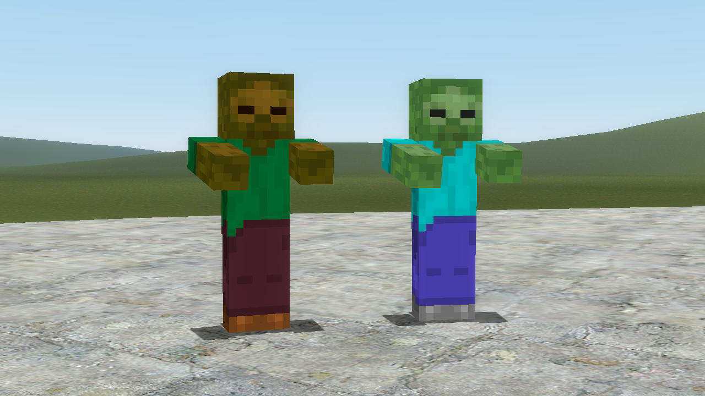

# BMB 自定义生物示例：余烬僵尸（Ember Zombie）

[English](README.md)

这是一个能直接运行的最小自定义生物示例，基于 [Minecraft in GMod | Mobs](https://steamcommunity.com/sharedfiles/filedetails/?id=3774268246)（BlockMob Base，下文简称 BMB）。



| | 原版僵尸 | 余烬僵尸 |
|---|---|---|
| 生命值 | 70 | 50 |
| 追击速度 | 约 71 单位/秒 | 100 单位/秒 |
| 近战 | 10.5 伤害 | 7 伤害，并点燃玩家 3 秒 |
| 阳光 | 会燃烧 | 不燃烧 |
| 岩浆和火方块 | 会着火 | 免疫 |
| 外观 | | 橙色染色 |

其余全部继承自 BMB 的僵尸：方块寻路、追击、近战、击退、音效和动画。

## 需要什么

- Garry's Mod
- [Minecraft in GMod | Mobs](https://steamcommunity.com/sharedfiles/filedetails/?id=3774268246)，以及它依赖的 [Minecraft in GMod | MineMod](https://steamcommunity.com/sharedfiles/filedetails/?id=3769103943)
- 自己做生物需要基础的 Lua。这个示例不需要任何建模工具。

## 安装和试玩

1. 把本文件夹放进 `garrysmod/addons/`，保证 `garrysmod/addons/bmb-custom-mob-example/lua/` 存在。文件夹叫什么名字都可以。
2. 开一张地图。
3. 打开生成菜单：**NPCs > BMB Example Mobs > Ember Zombie**。Entities 标签页里也有它。

## BMB 生物的结构

BMB 的生物就是普通的脚本实体（NextBot）。一个生物类主要是一组参数，加上一个很小的状态机。真正干活的是 BMB 的基础实体和共用的行为模块，你的生物通过继承拿到全部能力：

```
base_nextbot                     Garry's Mod
└─ bmb_base_mob                  移动、方块寻路、伤害、击退、渲染
   ├─ bmb_zombie                 近战怪：找目标、追、打
   │  └─ example_ember_zombie    本示例
   ├─ bmb_skeleton               远程怪
   ├─ bmb_passive_animal         bmb_pig、bmb_cow、bmb_sheep 等动物的父类
   └─ ...
```

Garry's Mod 的 `ENT.Base` 可以跨 addon 继承，所以你的 addon 不需要复制或修改 BMB 的任何文件，只要求玩家装了 BMB。

## 两个文件

### `lua/entities/example_ember_zombie.lua`：生物本体

文件名就是类名。

```lua
AddCSLuaFile()
DEFINE_BASECLASS("bmb_zombie")

ENT.Base = "bmb_zombie"
ENT.Type = "nextbot"
ENT.PrintName = "Ember Zombie"
```

`DEFINE_BASECLASS` 会给这个文件一个局部的 `BaseClass` 表，里面是父类的函数。当你重写某个函数、又想让父类的版本照常执行时，就调用 `BaseClass.函数名(self, ...)`。不要用 `self.BaseClass` 来做这件事：一旦有人继承你的生物，它就会无限递归。

**数值**就是普通字段。没写的字段沿用父类的值。

```lua
ENT.StartHealth = 50
ENT.RunSpeed = 100
ENT.AttackMoveSpeed = 100
ENT.AttackDamage = 7
ENT.BurnsInDaylight = false
ENT.FireImmune = true
ENT.BMBMinecraftEnemy = true
```

**外观**：示例直接给原版僵尸模型染色。BMB 的渲染支持 `Entity:SetColor()`。

```lua
function ENT:Initialize()
    BaseClass.Initialize(self) -- 一定先执行父类的初始化
    if CLIENT then return end

    self:SetColor(EMBER_COLOR)
end
```

**行为**：近战命中后，BMB 会立刻在服务端调用 `OnBMBMeleeHit`。示例保留了僵尸的命中音效，再加上点燃。

```lua
function ENT:OnBMBMeleeHit(target, damageInfo)
    BaseClass.OnBMBMeleeHit(self, target, damageInfo)

    if IsValid(target) and target:IsPlayer() and target:Alive() then
        target:Ignite(3)
    end
end
```

### `lua/autorun/example_ember_zombie.lua`：注册

这个文件用 `list.Set("NPC", ...)` 把生物加进生成菜单的 NPC 标签页，并向 BMB 的自然刷怪系统注册：

```lua
BMB.NaturalSpawn.Register(CLASS, {
    category = "monster",
    weight = 8,
})
```

注册放在 `InitPostEntity` 钩子里，因为 addon 的加载顺序没有保证。自然刷怪这部分是可选的；如果只想让生物出现在生成菜单里，把它删掉即可。

## 做你自己的生物

1. 复制这两个文件并改名。实体文件的文件名就是你的类名，只能用小写字母、数字和下划线。
2. 用你自己的前缀，例如 `yourname_frost_zombie`。不要以 `bmb_` 开头：这个前缀属于本体，将来官方出了同名生物会和你的冲突。
3. 在实体文件里改掉 `PrintName`、`Author` 和 `Category`，然后修改数值、外观和钩子。
4. 在 autorun 文件里改掉 `CLASS`、显示名、分类、全局表名（`ExampleEmberZombie`）和钩子名。
5. 重开地图。之后再修改实体文件，保存时会自动重载；自然刷怪的改动需要再重开一次地图才生效。

## 常用做法

本节的代码都在游戏里对着创意工坊版 BMB 实际跑过，小节里另有说明的除外。表格里的数字来自 BMB 的源码。

### 常用数值（僵尸家族）

| 字段 | 僵尸的值 | 含义 |
|---|---|---|
| `StartHealth` | 70 | 生命值。BMB 取 Minecraft 生命值 × 3.5，再乘以服务器的 `bmb_health_scale`。 |
| `WalkSpeed` | 约 71 | 游荡速度，单位/秒。 |
| `RunSpeed` | 约 71 | 追击速度。 |
| `AttackMoveSpeed` | 约 71 | 挥击时保持的速度。和 `RunSpeed` 保持一致。 |
| `AttackDamage` | 10.5 | 近战伤害。 |
| `AttackCooldown` | 1.0 | 两次攻击的间隔（秒）。 |
| `AttackRange` | 60 | 近战距离（单位）。 |
| `AttackKnockback` | 150 | 对受害者的水平击退。 |
| `TargetRange` | `35 * BMB.BS` | 发现目标的距离。 |
| `BurnsInDaylight` | `true` | 是否在阳光下燃烧。 |
| `FireImmune` | 未设置 | 设为 `true` 后免疫岩浆和火方块。 |
| `BMBMinecraftEnemy` | 未设置 | 设为 `true` 后其它生物把它当作敌对怪物，铁傀儡会攻击它。 |

`BMB.BS` 是一个方块的边长（Source 单位，目前是 36.5）。以方块计的距离请写成 `n * BMB.BS`，不要写死单位数。

完整的字段列表在 BMB 里父类实体文件的开头。

### 阅读 BMB 的源码

BMB 的 Lua 在它的创意工坊包里。用 Garry's Mod 自带的 `gmad.exe` 解包即可阅读：

```
GarrysMod\bin\gmad.exe extract -file "<Steam 库>\steamapps\workshop\content\4000\3774268246\<文件名>.gma" -out "C:\some\folder"
```

先看 `lua/entities/bmb_zombie.lua`，它是"一个生物文件能写什么"的最好参考。

### 换一个父类

把 `ENT.Base` 和 `DEFINE_BASECLASS` 改成 BMB 的其它类，例如 `bmb_skeleton`、`bmb_spider`、`bmb_creeper`，或者 `bmb_pig` 这样的动物。

本示例只实际跑过 `bmb_zombie`。其它父类原理相同，但各自的字段名和钩子不同，有些还有按自己类名登记的数据（比如猪的后代类）。用之前先读父类的文件。

### 音效

僵尸家族从 `ENT.Sounds` 读取音效，路径相对于 `sound/`。

```lua
ENT.Sounds = {
    Say   = { "yourname/ember/say1.ogg", "yourname/ember/say2.ogg", "yourname/ember/say3.ogg" },
    Hurt  = { "yourname/ember/hurt1.ogg", "yourname/ember/hurt2.ogg" },
    Death = { "yourname/ember/death.ogg" },
}
```

没写的列表（这里是 `Step` 和 `Hit`）沿用僵尸的音效。

有一个坑：Garry's Mod 会把子类的表逐项合并进父类的表。如果你的列表比父类的短，父类多出来的那几项会留在列表里。僵尸的列表分别有 3 个 `Say`、2 个 `Hurt`、1 个 `Death`、5 个 `Step`、3 个 `Hit`，所以你重写的每个列表至少要有这么多项。音效不够就重复填同一个文件。

### 自定义贴图

换皮不需要编译模型。

1. 解包出 BMB 的 `materials/models/mcgm/zombie/zombie.vtf`，用 VTFEdit 之类的工具打开，看清贴图布局。
2. 按这个布局画你自己的贴图，保存为 VTF 时开启点采样（Point Sample），像素才不会糊。
3. 连同材质文件一起放进你的 addon，例如 `materials/models/yourname/ember_zombie.vtf` 和 `ember_zombie.vmt`：

   ```
   "VertexLitGeneric"
   {
   	"$basetexture" "models/yourname/ember_zombie"
   	"$alphatest" "1"
   	"$alphatestreference" "0.5"
   	"$nocull" "1"
   }
   ```

4. 在 `Initialize` 里、`BaseClass.Initialize(self)` 之后应用：

   ```lua
   self:SetMaterial("models/yourname/ember_zombie")
   ```

`SetMaterial` 会替换模型上的所有材质。僵尸这种单贴图生物没问题；分多层绘制的生物需要编译模型。用了自己的贴图就把 `SetColor` 那行删掉，否则染色会叠在贴图上。

### 自定义模型

这是最难的部分，本示例没有覆盖。僵尸家族对模型的要求：

- `ENT.Model` 指向你编译好的 `.mdl`。
- 模型里要有名为 `root`、`head`、`rightArm`、`leftArm`、`rightLeg`、`leftLeg` 的骨骼。BMB 的僵尸模型里，骨骼链是 `root` > `waist` > `body`，头、双臂、双腿都挂在 `body` 下面。
- BMB 每帧用 Lua 旋转这些骨骼来做僵尸动画，所以模型不需要行走和攻击动画。BMB 的僵尸模型只有一个 `idle` 序列。
- 骨骼朝向要和 BMB 的僵尸模型一致。用 Crowbar 反编译 `models/mcgm/zombie/zombie.mdl`，以它的骨架为起点，否则四肢会绕错误的轴摆动。
- 体型变了的话，要相应设置 `ENT.CollisionMins` 和 `ENT.CollisionMaxs`。BMB 的寻路用这个盒子判断生物能不能通过。

### 它攻击谁

重写 `CanBMBTarget`。下面这个版本会无视蹲着的玩家，所以可以潜行绕过它：

```lua
function ENT:CanBMBTarget(target)
    if IsValid(target) and target:IsPlayer() and target:Crouching() then return false end
    return BaseClass.CanBMBTarget(self, target)
end
```

### 自己的状态机

僵尸的决策写在 `ENT:RunBMBZombieAI()` 里。BMB 先处理完死亡、物理枪抓取、击退等状态，然后在生物的行为协程里反复调用它。重写它，把你自己的判断放在前面，其余情况交回僵尸原来的状态机。

下面这个版本会原地不动，直到有玩家走进 4 格以内，或者它自己受伤：

```lua
local WAKE_DISTANCE = 4 * BMB.BS

local function playerNearby(self)
    for _, ply in ipairs(player.GetAll()) do
        if ply:Alive() and ply:GetPos():DistToSqr(self:GetPos()) < WAKE_DISTANCE * WAKE_DISTANCE then
            return true
        end
    end
    return false
end

function ENT:RunBMBZombieAI()
    if not self.Awake then
        if not playerNearby(self) and self:Health() >= self:GetMaxHealth() then
            self:SetBMBState("idle")
            self:InterruptibleWait(0.5) -- 这段代码运行在协程里，可以等待
            return                      -- BMB 随后会再次调用本函数
        end
        self.Awake = true
    end

    BaseClass.RunBMBZombieAI(self) -- 从这里开始就是普通僵尸
end
```

僵尸自己的状态机用到的行为模块是 `BMB.Behaviors.SeekTarget`、`BMB.Behaviors.Chase`、`BMB.Behaviors.MeleeAttack` 和 `BMB.Behaviors.Wander`。它们怎么组合，看 `bmb_zombie.lua` 里的 `RunBMBZombieAI`。

写移动相关的代码时有两条规矩：

- 重写 `RunBMBZombieAI`，不要重写 `RunBehaviour`。外层循环处理的那些状态，你的生物不能跳过。
- 不要用 `SetPos` 或 `SetAngles` 移动生物，让 BMB 的行为模块去移动它。

### 自然刷怪选项

`BMB.NaturalSpawn.Register(class, options)` 接受：

| 选项 | 含义 |
|---|---|
| `category` | `"monster"`（默认，暗处）、`"creature"`（动物，草地上的亮处）或 `"ambient"`（蝙蝠的规则：暗处且在地表以下）。 |
| `weight` | 同一分类内的相对概率。内置怪物：僵尸 30、骷髅 25、蜘蛛 20、苦力怕 15、史莱姆 7、洞穴蜘蛛 6、末影人 3。 |
| `packSizes` | 可选的成群数量列表，例如 `{ 2, 3 }`。默认单只。 |
| `limitConVar` | 一个 ConVar 的名字，用来限制这个类的存活数量。ConVar 需要你自己创建。 |
| `enabledConVar` | 一个 ConVar 的名字，用来开关这一条。 |
| `maxLight` | 仅怪物。允许刷新的最高光照等级，0 到 15。怪物本来就要求 7 以下。 |
| `spawnChance` | 仅怪物。0 到 1 的额外概率：找到合法位置后是否真的刷出。 |
| `condition` | 仅怪物。`function(world, cell, position)`，返回 `true`，或者 `false` 加原因。 |

本示例只用到 `category` 和 `weight`。其余选项是从 BMB 源码里整理出来的，没有在这里实际跑过。

测试时要知道的几件事：

- 自然刷怪默认关闭，用 `bmb_spawn_enabled 1` 打开。
- 怪物刷在离玩家 20 到 40 格、光照等级 7 以下的位置。
- 附近必须有 MineMod 方块。纯 Source 地图上没有方块光照数据，每次尝试都会以 `light_unknown` 失败。
- 白天的尝试会以 `light_15.00_over_7.00` 这样的原因失败。不想等天黑的话，先临时设 `bmb_spawn_max_light 15`，测完改回 7。
- `bmb_spawn_now monster`（仅管理员）会强制尝试一次并打印结果，例如 `[BMB spawn] forced monster spawn failed: outside_distance_band`。单次尝试经常落空，多执行几次。它是随机挑一个怪物条目，所以测试时把你的 `weight` 调得很大。

## 调试

- `bmb_debug_hud 1` 会在每只 BMB 生物头顶显示类名、生命值、状态和移动数据。
- `bmb_freeze 1` 会把所有 BMB 生物定在原地，方便截图；`bmb_freeze 0` 解除。
- 你的生物报的 Lua 错误和其它 addon 一样出现在控制台里。

## 目前的限制

- **没有掉落和经验。** BMB 的掉落表是按它自己的类名登记的，自定义类死亡时什么都不掉。
- **按类名写的反应不认识你的生物。** 例如村民躲僵尸这类逐个列出类名的行为，不会包含它。`ENT.BMBMinecraftEnemy = true` 只解决通用的"是不是怪物"判断。
- **还没有稳定的 API。** BMB 仍在变化。本示例用到的字段和钩子是最不容易变的那部分，更深的东西可能在更新里改掉。BMB 更新后请重新测试你的生物。
- **没有生成菜单图标。** 在 `materials/entities/<你的类名>.png` 放一张正方形 PNG 即可。

## 发布你的生物

- 仓库里带了给创意工坊上传工具用的 `addon.json`，记得改标题。
- 在你的创意工坊页面把 "Minecraft in GMod | Mobs" 添加为必需物品。
- 不要打包 BMB 的 Lua、模型、贴图或音效。你的 addon 只需要你自己的文件。
